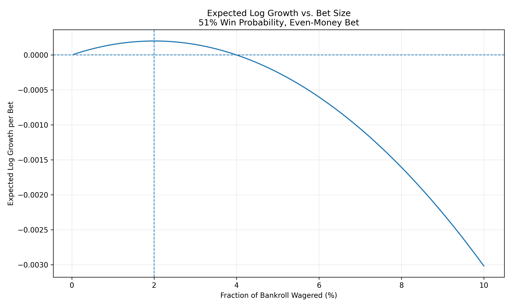
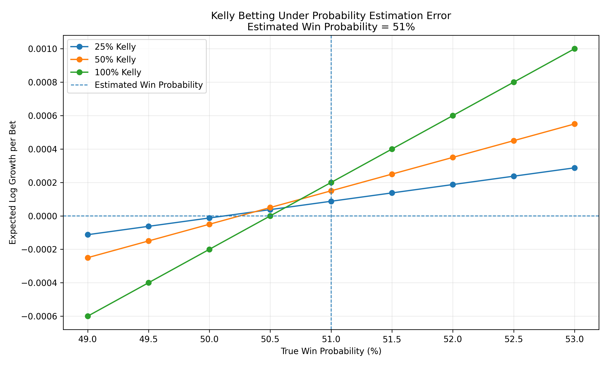
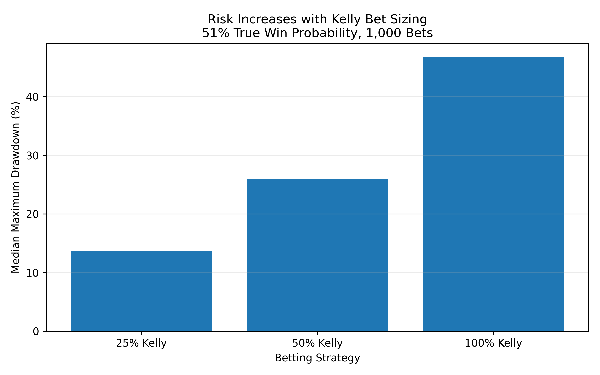

# Kelly Criterion Under Model Uncertainty

A Python Monte Carlo simulation exploring the Kelly criterion, fractional Kelly betting, and what happens when your estimated edge is wrong.

## What I Tested

I started with a simple even-money bet with a 51% win probability and a $1,000 bankroll.

The project looks at:

- How bet size affects long-term bankroll growth
- Whether Monte Carlo simulations match the Kelly criterion
- What happens when the estimated win probability is wrong
- How full, half, and quarter Kelly compare in terms of growth and drawdown

For an even-money bet, the Kelly fraction is:

\[
f^* = 2p - 1
\]

At a 51% win probability, this gives a 2% optimal bet size.

## Results

The simulations matched the theory pretty closely. With a 51% true win probability, the median final bankroll peaked around the 2% Kelly fraction.

One interesting result was what happened when bet sizes became too large:

| Bet Size | Median Final Bankroll |
|---:|---:|
| 1% | $1,139 |
| 2% | $1,221 |
| 5% | $778 |
| 10% | $49 |

Even with a positive edge, overbetting destroyed long-term compounded growth.



## Estimation Error

Kelly assumes the win probability is known. In reality, it would usually be estimated.

I assumed the bettor believed the win probability was 51%, then changed the actual probability while keeping the same bet sizing.

The break-even true probabilities were:

| Strategy | Bet Size | Break-Even Probability |
|---|---:|---:|
| Quarter Kelly | 0.5% | 50.125% |
| Half Kelly | 1.0% | 50.250% |
| Full Kelly | 2.0% | 50.500% |

Full Kelly gives more growth when the estimate is correct, but it is also more sensitive to being wrong.



## Drawdown

I also tracked the largest peak-to-trough loss during each simulation.

| Strategy | Median Final Bankroll | Median Max Drawdown |
|---|---:|---:|
| Quarter Kelly | $1,091 | 13.64% |
| Half Kelly | $1,162 | 26.19% |
| Full Kelly | $1,221 | 46.79% |

Full Kelly produced the highest median final bankroll, but also much larger drawdowns.



## Takeaway

Full Kelly works well when the estimated probability is accurate, but it can be aggressive when there is uncertainty in that estimate.

Fractional Kelly gives up some potential growth in exchange for lower drawdowns and more room for estimation error.

## Running It

Install the dependency:

```bash
pip install matplotlib
```

Then run:

```bash
python main.py
```